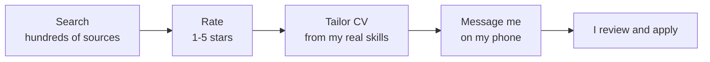
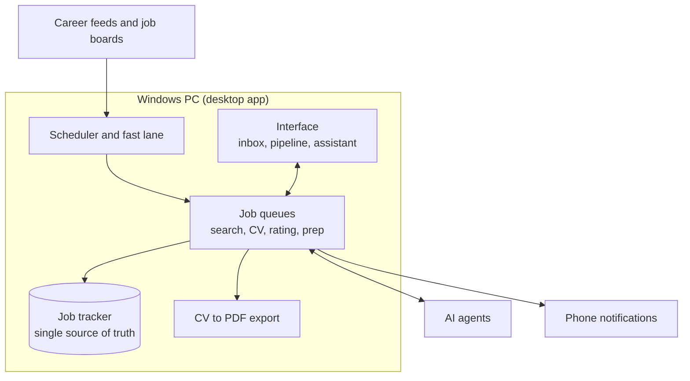

https://github.com/user-attachments/assets/d1e0d7b5-ebb5-410b-aea6-26d5ecda7a9a

# Job Studio

**A desktop app that runs my whole job hunt with AI agents. It finds new student jobs, rates them, writes a tailored one-page CV for each, and sends everything to my phone. I read it and apply myself.**

> Demo data in the video is fictional. This repo only holds the demo; the app itself is a private personal project.

---

## Why I built it

I'm a final-year Computer Science student in Israel, looking for a student position. Looking for one is a daily job on its own: dozens of company career pages, several job boards, and every posting needs a CV that matches it. Whoever applies first usually gets the call, so I wanted that routine automated, as a real example of **daily work automated with AI agents**.

The idea behind it: **let the agents do all the research and preparation, and keep the human in charge of the final decision.** That is the responsible way to use agents, not giving them total freedom.

## What it does

1. **Search.** It scans a watchlist of ~440 company career feeds, ~680 other career pages, and the main Israeli and international job boards, then removes everything it already knows about.
2. **Judge.** An AI agent reads each new posting against my criteria (student eligibility, role type, location) and decides whether it is a fit and which tier it belongs to.
3. **Rate.** Every fit gets 1-5 stars: how good the role is for a CS student in general, and how well it matches my skills and goals, with a one-line reason.
4. **Tailor.** A one-page CV is built **immediately** for every fit, using only my real skills and projects. It reorders and emphasizes what matters for that job and never invents anything. The result is exported to PDF.
5. **Message me.** The job, its stars, the link and the finished PDF arrive on my phone within minutes.
6. **I apply.** I open the pipeline, preview or edit the CV (by typing what I want changed), open the posting and apply myself, then press "Submitted".

## Features

| | |
|---|---|
| **Job inbox** | Everything found today, newest first, with stars, tier (A better / B fallback), company size and a short summary. |
| **Pipeline** | A and B tabs, "to submit / submitted / all", each job with Open CV, Edit CV, Open site and Submitted. |
| **Edit CV by chat** | Tell the agent what to change in plain words; it edits the CV and re-exports the PDF. No manual editing. |
| **Call prep** | After I apply, one button writes a one-minute cheat sheet for an incoming call: the company, the role, what they want vs. what I have, likely questions, logistics. |
| **Cover letter on demand** | A short cover letter only when I ask for it, in the same style as the CV. |
| **Fast lane** | Every 30 minutes (quiet hours at night) a light scan checks the sources that publish first and only the new jobs go to the agent, so I see a job within minutes of it going online. |
| **Full search** | A full pass several times a day, with a live progress bar: what is being searched right now and the percentage to the end. |
| **Scheduler** | Runs at set hours, wakes the PC from sleep for them, and catches up if the PC was off. |
| **Phone notifications** | New jobs, finished CVs, scheduled runs, problems and call prep arrive on my phone. |
| **Assistant** | An in-app chat that knows the state of everything and can act: "are we connected to everything?", "what do you think of the last job?", "change the schedule to 8, 12 and 18". |
| **Profile** | A large bank of questions and answers (education, languages, availability, and so on) so the agent always has the facts about me. |
| **Health checks** | Clear indicators for the AI login, phone connection, queues and a running search, plus a cancel button. |

## Responsible by design

- **Human-in-the-loop.** The agents never get total freedom. They prepare; I decide and submit.
- **No invented skills.** CVs are built from a fixed set of true facts about me. If a job asks for something I don't have, the CV does not claim it.
- **The agent hands back instead of guessing.** Anything it cannot do safely (a CAPTCHA, a password, an unknown question) is passed back to me, never worked around.
- **Hard rules, applied the same way every time.** For example: required documents are fine, a minimum-grade requirement excludes a job, and every decision is written down with its reason.
- **Private by default.** My data and credentials stay on my computer; nothing is shared with third parties other than the AI service and the notification service used to reach my phone.

## Architecture

- **Queues.** Search, CV building, rating and call prep run as persistent queues: serial, restart-safe, with retries, pause when the AI usage limit is reached, and cancel.
- **One tracker.** Every job ever seen lives in one file with a status and the reason it was kept or excluded, so nothing is looked at twice and nothing is lost if a step fails.
- **Cheap first, smart second.** Fast scripts do the broad scan; the AI agent is only used for judgment and writing, so it stays quick and light on resources.

## Tech stack

- **Windows desktop app** in Node.js with a custom dark interface
- **Python** for the scanning and PDF tooling
- **Claude** as the AI agent, run headless through my own subscription
- A plain, auditable tracker file as the single source of truth
- Push notifications to the phone; a Windows scheduled task for waking the PC

## What I learned

- Agents are best when the task is split in small, checkable steps with hard rules, not one big prompt.
- Reliability is most of the work: retries, state that survives restarts, and a clear "what is it doing right now" view.
- The most useful design choice was keeping the final decision with me.

## Status

Personal project, in daily use. Built by **Eylon Hakak**, Computer Science B.Sc. student at Bar-Ilan University.)
